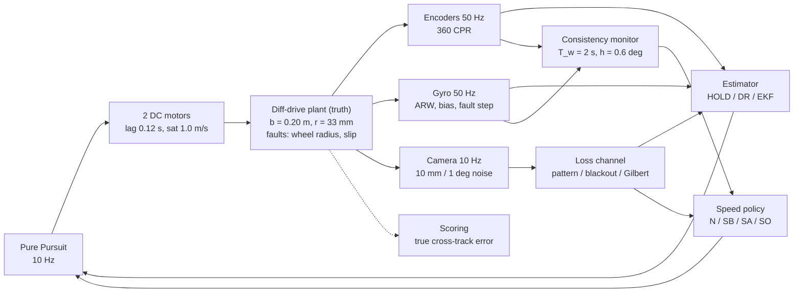

# PLAN: Consistency-Gated Slowdown for Pure-Pursuit Robots During Camera Blackouts

| | |
|---|---|
| **Version** | rev 3.1, 2026-11-23 (rev 3 plus Codex follow-up 1b: exact wheel-travel integration, short-blackout fault timing, SB precedent) |
| **Status** | Design complete, waiting for Codex round 2 (§19). **No experiment has been run on this design.** `sim/sim.js` is draft v0: untested, 2 known bugs, parameters not yet updated to rev 3 |
| **People** | Pushkar: PI, paper, viva · Claude: simulator, experiments, analysis, firmware · Codex: independent review, reference implementation |
| **Course** | DSEU BT-PR701 Project-I (4 credits). Target: a 6-page IEEE-format workshop paper |
| **Data** | 100% simulated, seeded, reproducible. Never presented as measured |
| **Working title** | *Slow Down Only When Sensors Disagree: Consistency-Gated Speed Control for Differential-Drive Robots During Camera Blackouts* |

**Contents:**
1. Summary
2. Research questions and hypotheses
3. Contributions and positioning
4. System model
5. Methods
6. Analysis: closed-form predictions
7. Experiments
8. Metrics and statistics
9. Verification
10. Figures, tables, paper skeleton
11. Evidence so far
12. Repository layout
13. Milestones
14. Risks and kill criteria
15. Not doing
16. Open questions
17. Change log
18. References
19. Codex Suggest (round 2)

---

## 1. Summary

**Problem (how might we).** How might a differential-drive warehouse robot that loses its overhead-camera fix at a turn stay inside a ±30 mm corridor, *without* slowing down on every blackout?

**Approach.**
- During a blackout the robot dead-reckons with quantized wheel encoders and a gyro, fused in an EKF.
- A **consistency monitor** compares the heading change measured by the gyro with the heading change measured by the encoders over a 2 s window.
- The robot slows to 30% speed **only when they disagree** (policy SA).
- SA is compared on paired seeds against three other policies:
  - never slowing (N),
  - slowing on every blackout (SB),
  - an oracle that slows exactly when a fault starts (SO).

**Headline claim, predicted in closed form (§6.9), to be measured in B0.** Take a 4 s blackout with a +1°/s gyro fault.
- SA's peak excess error is predicted at 17.1 mm, against 16.0 mm for SB and 53.5 mm for N.
- On healthy blackouts SA loses **0 s**, while SB loses **2.6 s per blackout**.

**Why it isn't trivial.**
- *That* SA lands between N and SB follows from how the policies are built. *How far* it sits from each is the real question, and §6 derives it:
  - regret against the oracle: $\tfrac12 v(1-\alpha)h^2/b$;
  - a fault-size cutoff: $b_{min}=h/T_w$;
  - a threshold design window: $0.42° \le h \le 0.86°$.
- The simulation tests these predictions, including the cases where the monitor *can't* help: faults below $b_{min}$, and disagreements that do no harm.

**MVP (minimum publishable unit).** V checks → Part A → CAL → B0 → main figure F2 → demo. Everything else is secondary.

**Assessment.** As a college project: 9/10. As a workshop paper with simulation only: about 7. Up to about 7.5 if the §6 predictions match the simulation within 20% across the Part C sweeps. Below 7 if the results only show orderings that follow from how the policies are built.

---

## 2. Research questions and pre-registered hypotheses

Decision rules are fixed **before** any scored run. The tests are defined in §8.

| ID | Question | Hypothesis / decision rule | Experiment | Role |
|---|---|---|---|---|
| **P1** | Is selective slowdown as safe as blanket slowdown? | Fault runs, primary cell: the paired median of $e_{ex}^{SA}-e_{ex}^{SB}$ has its upper 95% CI bound **< δ_S = 5 mm** (non-inferiority). Predicted +1.1 mm | B0 | **Primary** |
| **P2** | Does it save time? | Healthy runs, primary cell: the paired median of $T_c^{SB}-T_c^{SA}$ has its lower 95% CI bound **> 0**. Predicted +2.6 s | B0 | **Primary** |
| **P3** | Is slowing worth it at all? | Fault runs: the paired median of $e_{ex}^{N}-e_{ex}^{SA}$ has its lower 95% CI bound **> 0**. Predicted +36 mm | B0 | **Primary** |
| P4 | False alarms | False-alarm rate over the **independent** healthy blackout scenarios (unique cell × seed; arms share noise, so arms aren't counted separately), reported with a Clopper–Pearson 95% upper bound. Target: 0 alarms. B0 + B give ≈ 240 unique scenarios, so 0/240 → upper bound ≈ 1.2% | B0, B | Primary (reported) |
| H1a | Short gaps: do DR and EKF help? | $e_{ex}^{HOLD}-e_{ex}^{DR}>0$ and $e_{ex}^{HOLD}-e_{ex}^{EKF}>0$ (paired, burst of 8, entry and exit) | A | Secondary |
| H1b | Do DR and EKF track the same? | Equivalence (TOST): the 90% CI of the paired median $e_{ex}^{DR}-e_{ex}^{EKF}$ lies inside **±δ_A = ±3 mm**. Predicted difference 1–3 mm, so **this may come out inconclusive**. That's an honest outcome | A | Secondary |
| H1c | Where does the EKF win? | EKF < DR on peak estimate error (predicted ≈ 4×) and on steering jump (predicted ≈ 10×) | A | Secondary |
| H2 | Does fault type change where the error appears? | Pattern of fault × onset matches §6.3: gyro faults phase-independent; wheel-size fault zero on straights; differential fault harmless for DR/EKF but triggers SA | B | Exploratory |
| H3 | Are the formulas right? | Simulated drift is within 20% of the §6 formulas; regret curve and $b_{min}$ cutoff match §6.7 | V7, C | Secondary |
| H4 | Burstiness | At a matched 10% loss, peak error rises with mean burst length for HOLD and stays flat for DR and EKF | D | Exploratory |

**Primary cell.** R = 1.0 m, v = 0.5 m/s, T_b = 4 s, onset at arc entry, gyro step +1°/s at onset + 0.5 s. P1–P3 are Holm-corrected as one family. All other B0 cells are reported as secondary.

---

## 3. Contributions and positioning

**Claimed:**
1. **C1. Closed-form blackout analysis** for Pure Pursuit plus encoder/gyro dead reckoning: drift envelopes for each fault type, survival time $T^*$, and the regret of a delayed, detection-triggered slowdown.
2. **C2. Threshold design window** for a gyro–encoder consistency monitor. The floor comes from encoder quantization ($2\,\mathrm{res}/b$). The ceiling comes from the corridor and the blackout budget ($2e_{tol}T_w/(vT_{max}^2)$).
3. **C3. A controlled paired study** of about 10k simulated runs with common random numbers: selective vs. blanket vs. oracle slowdown, plus HOLD/DR/EKF on short gaps, with equivalence and non-inferiority tests.
4. **C4. An open artifact:** browser simulator, dataset, and an ESP32 (Wokwi) port shown to match the simulator.

**Not claimed:**
- Real-world validation.
- Optimality of the policy.
- Generality beyond kinematic diff-drive at ≤ 0.7 m/s indoors.
- Novelty of comparing gyro and odometry as such (Gyrodometry, 1996).

| Closest work | What it does | What we add |
|---|---|---|
| Borenstein & Feng, ICRA 1996 (Gyrodometry) | Switches heading source when gyro and odometry disagree (bumps) | Disagreement used to **gate speed during camera blackouts**; threshold design window; regret analysis |
| Batavia, Roth & Singh, IROS 2002 | Pure Pursuit + EKF (GPS, encoders, gyro) through GPS outages on a field robot | Controlled fault injection, paired policy comparison, closed-form predictions |
| **Heydari Shahna, Mustalahti & Mattila, RAS 2026, §3.3** | Supervisor **brakes on any localization fault**, including a pose-stream timeout ($T_{lost}$ = 0.50 s, Table 11), on a 6000 kg skid-steered robot. Single policy; 2 injected-fault runs | **Precedent for our SB arm.** We measure what gating the brake on gyro–encoder disagreement (SA) buys over SB, and what it costs |
| Sinopoli et al. 2004; Huang & Dey 2007; Kluge et al. 2010 | KF/EKF stability under intermittent and Markov loss | Corridor safety and speed policy, not covariance stability |
| Carbonell et al. 2024; Ferrari et al. 2026 | Networked path following under packet drops or Wi-Fi timing | Interaction of onboard sensor faults with blackouts by turn phase |
| Liu, Candell & Moayeri 2017 | Random vs. bursty loss at a matched rate (process control) | Same matched-rate idea for a mobile robot (Part D) |

**Literature gap still to close (before writing §II):** uncertainty-aware or safe speed limiting under degraded localization, and other AMR localization-fault supervisors besides Heydari Shahna et al.

---

## 4. System model



### 4.1 Parameters (the single source in code is `sim/params.js`)

| Block | Symbol | Value | Why |
|---|---|---|---|
| Route | $L_1$, R, $L_3$ | 3.0 m, {0.55, 1.0, 1.5} m, **5.0 m** | $L_3$ = 5 m fits a 4 s exit-onset blackout plus 3 s scoring at 0.7 m/s (V10) |
| Robot | b, r | 0.20 m, 0.033 m | Small AMR (Codex) |
| Speed | v | 0.2 (A), 0.5 (B, S), {0.3, 0.5, 0.7} (C) m/s | Short gaps at v1 speed; blackouts at AMR speed |
| Lookahead | $L_d$ | **fixed per experiment:** 0.15 m (A), 0.30 m (B, C, S) | Fixed so speed and lookahead aren't confounded; time-scaled only in C3 |
| Motors | τ, $u_{max}$ | 0.12 s, 1.0 m/s | Codex v2; exact discretisation |
| Encoders | N, res | 360 CPR, 0.576 mm/count | 6.9 counts per 20 ms at 0.2 m/s; 17.4 at 0.5 m/s |
| Gyro | ARW N | 0.015°/√s (0.106°/s per sample) | Assumed MEMS class |
| | bias instability | Gauss–Markov σ = 0.004°/s, τ = 100 s | Assumed |
| | turn-on bias | σ = 1°/s, removed by the 1 s stationary calibration | Codex v2 |
| | warm-up | 0.2°/s amplitude, τ = 120 s | Assumed; tracked by the EKF bias state |
| Camera | $\sigma_{xy}$, $\sigma_\theta$, latency | 10 mm, 1°, 0 ms | Latency is a threat (T3), extension E1 |
| Clocks | Δt, sensors, camera, steering | 10 ms, 50 Hz, 10 Hz, 10 Hz (all arms) | Fair comparison (Codex) |
| Monitor | $T_w$, h, g | 2.0 s, 0.6°, 0.3 s | §6.8 window; frozen after CAL |
| Policy | α | 0.3 (0.15 m/s at 0.5 m/s); sweep {0.2, 0.5} in S3 | Same cap for SB, SA and SO |
| Safety | $e_{tol}$ | 30 mm corridor | Fixed a priori |
| Randomness | — | mulberry32, separate stream per sensor, **common random numbers** across arms | Paired comparisons |

### 4.2 Model equations

- **Plant:** $\dot x=v\cos\theta,\ \dot y=v\sin\theta,\ \dot\theta=\omega$, with $v=\tfrac{g_R+g_L}{2}$, $\omega=\tfrac{g_R-g_L}{b}$, and ground speed $g_i=\dot\phi_i\,r(1+\varepsilon_i)(1-s_i(t))$. Integrated with midpoint heading.
- **Motors and wheel travel** (both exact for a command held over Δt; Codex 1b): $u_{L,R}^*=\mathrm{sat}(v_c\mp b\,\omega_c/2)$.
  - Speed: $u_i \leftarrow u_i^*+(u_i-u_i^*)e^{-\Delta t/\tau}$.
  - Displacement: $\Delta\ell_i=u_i^*\Delta t+(u_{i,0}-u_i^*)\,\tau(1-e^{-\Delta t/\tau})$.
  - Encoder rotation is $\Delta\phi_i=\Delta\ell_i/r$. Ground displacement is $\Delta\ell_i(1+\varepsilon_i)(1-s_i)$, and the pose update uses its mean and difference with midpoint heading.
  - Without the displacement integral, V4 fails (1.178 mm); with it, V4 passes (0.002 mm, Codex check).
- **Encoders:** $n_i=\lfloor\phi_i N/2\pi\rfloor$, $d_i=2\pi r\,\Delta n_i/N$. They count wheel *rotation*, so slip and radius error are invisible to them.
- **Gyro:** $\omega_g=\omega+b_0+b_w(t)+b_{GM,k}+b_f\mathbb{1}[t\ge t_f]+\eta_k$. Here ω is the yaw rate from the **instantaneous** ground speeds at the sensor tick, and:
  - $\eta_k\sim\mathcal N(0,N^2/\Delta t_s)$;
  - $b_{GM,k+1}=\phi b_{GM,k}+\sigma_{GM}\sqrt{1-\phi^2}\,w_k$, with $\phi=e^{-\Delta t_s/\tau_{GM}}$.
- **Camera:** $z=[x,y,\theta]^\top+\mathcal N(0,\mathrm{diag}(\sigma_{xy}^2,\sigma_{xy}^2,\sigma_\theta^2))$. It is delivered only if its 100 ms slot isn't lost. Noise is drawn for every slot to keep the random streams paired.
- **Gilbert channel:** $P(G\!\to\!B)=\frac{\lambda}{1-\lambda}\bar L^{-1}$, $P(B\!\to\!G)=\bar L^{-1}$. Every report in the bad state is lost (λ = 0.10).

---

## 5. Methods

### 5.1 Estimators (local sensing at 50 Hz, steering at 10 Hz)

| Arm | Report delivered | Report missing |
|---|---|---|
| **HOLD** | Steer from the camera pose | Keep the last $(v_c,\omega_c)$ (the v1 baseline) |
| **DR** | Reset the pose to the camera report | Integrate encoders + gyro with the calibrated bias $b_{cal}$ |
| **EKF** | Kalman update | Predict with encoders + gyro; bias is a state |

**EKF.** State $\mathbf x=[x,y,\theta,b_g]^\top$, with $\Delta s=(d_L+d_R)/2$.

- **Predict:** $x^-=x+\Delta s\cos\theta$, $y^-=y+\Delta s\sin\theta$, $\theta^-=\theta+(\omega_g-b_g)\Delta t_s$, $b_g^-=b_g$.
- **Covariance propagation:** $P^-=FPF^\top+G\,\mathrm{diag}(\sigma_{\Delta s}^2,\,N^2\Delta t_s)\,G^\top+\mathrm{diag}(0,0,0,q_b)$, where
  - $F=I+\begin{bmatrix}0&0&-\Delta s\sin\theta&0\\0&0&\Delta s\cos\theta&0\\0&0&0&-\Delta t_s\\0&0&0&0\end{bmatrix}$,
  - $G=\begin{bmatrix}\cos\theta&0\\\sin\theta&0\\0&1\\0&0\end{bmatrix}$,
  - $\sigma_{\Delta s}^2=\mathrm{res}^2/12+(0.01\,\Delta s)^2$, and $q_b=(3\times10^{-6})^2$.
- **Update:** $H=[I_3\;0]$, $R=\mathrm{diag}(\sigma_{xy}^2,\sigma_{xy}^2,\sigma_\theta^2)$. The heading innovation is wrapped to $(-\pi,\pi]$ and P is symmetrized afterwards.
- **Initialisation** at the end of calibration: $b_g=b_{cal}$, $P_{bb}=N^2/(\Delta t_s\,n_{cal})$.

### 5.2 Pure Pursuit

The target is $g=\Gamma(s_p+L_d)$, where $s_p$ is the projection of the *estimated* pose onto the route Γ. With $y_g$ the target's lateral offset in the robot frame and $d=\lVert g-\hat p\rVert$, the turn rate is $\omega_c=2v_c\,y_g/d^2$. $L_d$ stays fixed when the speed is capped, so the curvature command doesn't change.

### 5.3 Consistency monitor

- **Heading sources:** $\theta_g(t)=\int(\omega_g-\hat b)\,dt$ and $\theta_e(t)=\sum(d_R-d_L)/b$.
- **Residual:** $D(t)=[\theta_g(t)-\theta_g(t-T_w)]-[\theta_e(t)-\theta_e(t-T_w)]$.
- **Alarm:** fires when $\lvert D\rvert>h$ **and** $t-t_{fix}>g$. It clears at the next delivered report.

### 5.4 Speed policies (Parts B, C, S; all on the same EKF)

| Arm | $v_c$ during a blackout | Deployable? |
|---|---|---|
| **N** (EKF-N) | v | yes |
| **SB** (slow on every blackout) | αv once $t-t_{fix}>g$ | yes |
| **SA** (slow on alarm) | αv while the alarm is on | yes |
| **SO** (oracle) | αv once $t\ge t_f$ and $t-t_{fix}>g$. Persistent faults count as $t_f=0$, which makes SO equal to SB for them | **no**, reference bound |

All four share α, g, the release rule (back to v at the next report) and the motor model.

---

## 6. Analysis: closed-form predictions, derived before running

**Scope.** These are first-order, small-angle, straight-path approximations of **position-estimate drift**, with t measured from fault onset $t_f$ (or from the blackout start for noise and HOLD). The controller keeps the *estimate* on the route, so true cross-track error ≈ drift. That is compared against, not assumed. Matching these formulas with the simulator is **verification of one model**, not validation against reality (T1).

**6.1 Pure Pursuit is exact on a steady arc.** With an arc-length lookahead from the projection, the steady state gives $r^2=R^2$. So holding the command mid-arc costs nothing (the v1 result).

**6.2 HOLD across a curvature jump.** $e\le\Delta\kappa(vT_g)^2/2$. This is an upper bound; the prototype measured about ⅓ of it because of lookahead preview.

**6.3 Drift envelopes by fault (DR and EKF take heading from the gyro):**

| Fault | Predicted effect | Phase dependence | Monitor residual |
|---|---|---|---|
| Gyro step $b_f$ | $e\approx\tfrac12 v b_f t^2$ | none (first order) | $\lvert D\rvert=b_f\min(t,T_w)$ |
| Gyro ARW | $\sigma_e\approx vNt^{3/2}/\sqrt3$ | none | $\sigma_D=N\sqrt{T_w}=0.021°$ |
| Both wheels +ε | Encoders under-read by ε. The robot drives radius $R(1+\varepsilon)$, giving outward error $e\approx-\varepsilon R(1-\cos\varphi_b)$, where $\varphi_b$ = arc angle covered during the blackout | **zero on straights** | $\lvert D\rvert\approx\varepsilon\lvert\Delta\theta\rvert$ (turns only): 1.7° per window at R = 1 m |
| Wheels −δ/2, +δ/2 | ≈ 0 tracking effect (heading comes from the gyro) | none | $\lvert D\rvert\approx v\delta T_w/b$ = 5.7°, so SA = SB ("harmless disagreement") |
| Slip s on one wheel for $T_s$ | Real yaw disturbance $sv T_s/b$ (7.2°) that the gyro sees and Pure Pursuit corrects; measured, not predicted | weak | $\lvert D\rvert\approx s u T_s/b$ = 7.2° |
| HOLD | §6.2 | entry and exit only | — |

**6.4 DR vs. EKF on short gaps.** During the gap, both arms run the same prediction. DR starts the gap from the last camera fix (σ_θ = 1°). The EKF starts from its posterior, which is several times tighter. Predicted $e^{DR}-e^{EKF}\approx vT_g(\sigma_\theta^{cam}-\sigma_\theta^{post})$, about 1–3 mm for the burst of 8 at 0.2 m/s (0.9 s). The EKF's real advantages are the estimate error (≈ camera noise for DR) and the steering jump when the camera returns.

**6.5 Survival time** for arm N: $T^*=\sqrt{2e_{tol}/(v b_f)}$. That is 2.62 s for 1°/s and 3.71 s for 0.5°/s, at 0.5 m/s.

**6.6 Detection.** $t_d=h/b_f$ when $b_f>b_{min}=h/T_w$. That gives $b_{min}$ = 0.3°/s, and $t_d$ = 0.60 s at 1°/s and 1.20 s at 0.5°/s. For the wheel-size fault in the arc at R = 1 m: $t_d=h/(\varepsilon\omega)$ = 0.70 s.

**6.7 Policy regret.** The lateral drift rate is $v(t)\,b_f(t-t_f)$. Integrating over fault exposure T, with α the speed fraction:

$$e_N=\tfrac12 v b_f T^2,\qquad e_{SO}=\alpha e_N,\qquad e_{SA}=\tfrac12 v b_f\left[\alpha T^2+(1-\alpha)t_d^2\right]$$

$$\text{regret}=e_{SA}-e_{SO}=\tfrac12 v(1-\alpha)\,h^2/b_f\quad(b_f>b_{min});\qquad =(1-\alpha)e_N\quad(b_f<b_{min},\ \text{never detected})$$

- Regret is **largest at $b_{min}$**: 11.2 mm just below it, 3.7 mm just above it.
- It **falls as 1/b** for bigger faults: 1.1 mm at 1°/s.
- Bigger faults are detected faster, so they cost less regret.
- **Time cost** of running at αv for a duration $D_s$ is $(1-\alpha)D_s$. That gives SB $(1-\alpha)(T_b-g)$ on *every* blackout, and SA 0 on healthy blackouts.

**6.8 Threshold design window.** The threshold h has a floor and a ceiling:

$$h_{min}=\underbrace{2\,\mathrm{res}/b}_{0.33°\ \text{quantization}}+\underbrace{4N\sqrt{T_w}}_{0.08°}=0.42°,\qquad h_{max}=\frac{2e_{tol}T_w}{vT_{max}^2}=0.86°$$

- The floor comes from encoder quantization over the window. One count of L/R difference is 0.165°, and the windowed error is ≤ 2 counts *whatever the window length*. That's why the monitor uses a window rather than the raw rate, which would show 8.3°/s of per-sample noise.
- The ceiling guarantees that any fault too small to detect also stays inside the corridor for the longest blackout ($T_{max}$ = 4 s).
- The chosen h = 0.6° sits inside the window.

**6.9 Predicted B0 values** (gyro +1°/s at onset + 0.5 s; predicted excess drift; time lost against no-loss):

| $T_b$ | Arm | $e_{ex}$ (mm) | $\Delta T_c$ healthy (s) | $\Delta T_c$ fault (s) |
|---|---|---:|---:|---:|
| 4 s | N | 53.5 | 0 | 0 |
| 4 s | SB | 16.0 | 2.59 | 2.59 |
| 4 s | SA | **17.1** | **0** | 2.03 |
| 4 s | SO | 16.0 | 0 | 2.45 |
| 2 s | N | 9.8 | 0 | 0 |
| 2 s | SB | 2.9 | 1.19 | 1.19 |
| 2 s | SA | 4.0 | 0 | 0.63 |
| 2 s | SO | 2.9 | 0 | 1.05 |

Implication to test: for blackouts shorter than $t_f+T^*$ (≈ 3.1 s here), even N stays inside the corridor. There, slowing buys almost nothing and SB's time cost is pure loss.

**6.10 Theory context.** Sinopoli et al. (2004) bound the critical arrival rate of a *linear* KF below by $1-1/\max\lvert\lambda(A)\rvert^2$. That is 0 for marginally stable dead reckoning. It's background only: it doesn't settle the stability of this nonlinear EKF (Codex). Our measure is time-to-breach (6.5).

---

## 7. Experiments

**Run order:** V → A → CAL → (freeze h) → **B0** → check K1–K4 → B → C → D → S.

| ID | Purpose | Factors and levels | Arms | Seeds | Runs | `results/` folder |
|---|---|---|---|---|---:|---|
| **V** | Verification (§9) | 12 configs plus every R×v baseline | all | 1–3 | ~200 | `v_verification/` |
| **A** | H1 short gaps | R = 0.55, v = 0.2, $L_d$ = 0.15. Patterns {8 isolated, 2×4, burst of 8}, centred on {entry, mid, exit} (keeps mean slot 9.5). Faults {none, slip} | HOLD, DR, EKF | 1–20 | 1,080 | `a_estimators_short_gaps/` |
| **CAL** | Freeze h | Healthy. $T_b$ {0.5, 1, 2, 4} × onset {pre-entry straight, entry, mid, exit}, B settings | EKF (monitor passive) | **101–130** (never scored) | 480 | `cal_monitor/` |
| **B0** | P1–P4 | R = 1.0, v = 0.5, $T_b$ {2, 4} × onset {entry, mid} × {healthy, gyro +1°/s} | N, SB, SA, SO | 1–30 | 960 | `b0_policy_primary/` |
| **B** | H2 map | $T_b$ {0.5, 1, 2, 4} × onset {pre-entry, entry, mid, exit} × faults {none, slip, gyro +0.5, gyro +1, wheels +3%, wheels ±1%} | DR, N, SB, SA, SO | 1–10 | 4,800 | `b_fault_map/` |
| **C1** | Scaling | $T_b$ = 4, entry onset, R {0.55, 1, 1.5} × v {0.3, 0.5, 0.7} × {gyro +1, wheels +3%}; $L_d$ = 0.30 | N, SA, SO | 1–10 | 540 | `c_scaling/` |
| **C2** | Regret curve and $b_{min}$ | $T_b$ = 4, entry, R = 1, v = 0.5, $b_f$ ∈ {0.2, 0.3, 0.4, 0.5, 0.75, 1, 1.5, 2}°/s | N, SA, SO | 1–10 | 240 | `c_scaling/` |
| **C3** | Time-scaled lookahead | As C1 at R = 1 with $L_d$ = 0.6 s × v | N, SA | 1–10 | 120 | `c_scaling/` |
| **D** | H4 burstiness | Gilbert λ = 0.10, $\bar L$ {1, 4, 8, 16} reports, whole route, R = 1, v = 0.5, healthy | HOLD, DR, EKF | 1–30 | 360 | `d_burstiness/` |
| **S** | Sensitivity | On the B0 grid: S1 gyro noise ×2; S2 camera σ ×2; S3 α {0.2, 0.5}; S4 50 Hz steering (all arms) | B0 arms | 1–10 | 1,280 | `s_sensitivity/` |

Total: about 10,000 scored runs plus no-loss references. In a Web Worker that's under 2 min.

**Scoring rules (frozen):**
1. **Placement.**
   - A: 20-slot windows centred on the no-loss entry, mid and exit times (as in v1).
   - B, C, S: blackouts anchored by **onset**, the first missed report. "Pre-entry" means the blackout ends 1.0 s before the no-loss entry time.
   - Each run records the seconds of blackout spent on the first straight, the arc and the exit straight.
2. **Window.** $W=[t_{on},\,t_{ret}+3\,\mathrm{s}]$, where $t_{ret}$ is the first delivered report. A truncated window is flagged, never silently shortened (V10).
3. **Reference.** Same seed, arm, faults and fault timing, with no camera loss. Excess is computed against this.
4. **Faults.**
   - Gyro step at $t_f=t_{on}+\min(0.5\,\mathrm{s},\,T_b/4)$, i.e. 0.125 / 0.25 / 0.5 / 0.5 s for $T_b$ = 0.5 / 1 / 2 / 4 s (Codex 1b). Without the cap, a 0.5 s blackout would put the fault exactly at camera return. The timestamp is recorded, along with whether the alarm or the camera return came first.
   - Slip on the right wheel, s = 0.1, from $t_{on}+0.3$ s for 0.5 s.
   - Wheel-radius faults last the whole run.
5. **Seeds.** CAL 101–130; scored 1–30. Same seed means the same noise for every arm (CRN).

**CAL protocol (pre-registered):**
1. Run CAL and record, for each run, $\max\lvert D\rvert$ inside the gated intervals.
2. If every value is < 0.6°, keep h = 0.6°.
3. Otherwise set h = 1.25 × the observed maximum.
4. If that exceeds $h_{max}$ = 0.86°, trigger **K2**.
5. Freeze h in `sim/params.js` and record the commit hash before any B0 run.

---

## 8. Metrics and statistics

| Metric | Definition | Unit | Used in |
|---|---|---|---|
| $e(t)$ | Signed distance from the **true** pose to the continuous route (left = +) | mm | all |
| $e_{pk}$, $e_{ex}$ | $\max_W\lvert e\rvert$; $e_{pk}-e_{pk}^{ref}$ | mm | A, B0, B, C (primary for policy and drift claims) |
| $e_{sgn}$ | e at the argmax: rack side or aisle side | mm | B |
| breach | $\mathbb 1[\max_W\lvert e\rvert>30\,\mathrm{mm}]$ on absolute error | — | B0, B |
| $T_{surv}$ | First breach time minus $t_f$ | s | B, C |
| $\hat e_{pk}$ | $\max_W\lVert\hat p-p\rVert$ | mm | A |
| jump | $\lvert\omega_c(t_{ret})-\omega_c(t_{ret}^-)\rvert$ | rad/s | A |
| $T_c$, $\Delta T_c$ | Route completion time; minus the reference | s | B0, B, S |
| $t_d$ | First alarm minus $t_f$ | s | B0, B, C2 |
| FA | Any alarm in a healthy run | — | CAL, B0, B |
| NEES | Mean over blackout samples of $e_p^\top P_{xy}^{-1}e_p$ (**2-D position**; consistent ≈ 2) | — | V5, B |
| D-metrics | Fraction of time with $\lvert e\rvert>30$ mm, RMS e, **realised** loss rate and burst histogram | — | D |

**Statistical plan:**
- **Unit of analysis = seed.** Time steps are never treated as samples (no pseudo-replication).
- **Paired by seed.** Statistic: median of paired differences. CI: percentile bootstrap over seeds, 10,000 resamples, seeded.
- **Tests:**
  - superiority: paired sign-flip permutation test, 100,000 permutations;
  - non-inferiority (P1): upper 95% bound < δ_S;
  - equivalence (H1b): TOST through the 90% CI ⊂ ±δ_A;
  - false alarms: Clopper–Pearson.
- **Multiplicity:** Holm across P1–P3. Secondary families are reported with CIs and labelled *secondary* or *exploratory*.
- **[FLAG] Common random numbers make paired variance tiny,** so p-values go to zero for differences nobody cares about. Decisions therefore use the margins **δ_A = 3 mm** (10% of the corridor) and **δ_S = 5 mm** (1/6 of the corridor), fixed now, not p < 0.05 alone.
- **Reporting format:** median [IQR] per arm, plus paired median Δ with 95% CI, in mm or s. Every number in the paper traces to a `results/` CSV and a commit hash.
- **Tools:** Python 3, numpy, scipy 1.15, matplotlib.

---

## 9. Verification (M1 gate; all must pass before any scored run)

| ID | Check | Pass criterion |
|---|---|---|
| V1 | Determinism | Same config + seed run twice gives identical CSV rows |
| V2 | Loss schedule | Logged dropped slots equal the scheduled ones exactly (all patterns, blackouts, Gilbert) |
| V3 | No-loss baselines | $e_{pk}$ < 15 mm for every R×v used. Failing configs are excluded from breach metrics and reported |
| V4 | Timestep convergence | $\lvert\Delta e_{ex}\rvert$ < 1 mm between Δt = 10 ms and 5 ms on 12 configs, **including Codex's case** (seed 7, R = 1, v = 0.5, 4 s exit, +1°/s). Codex measured: draft Euler 1.264 mm, exact speed only 1.178 mm, exact speed + wheel travel 0.002 mm |
| V5 | EKF consistency | Mean 2-D NEES in [1.0, 3.5] on no-loss healthy runs |
| V6 | Gyro generator | Allan deviation of a 1 h synthetic stationary log recovers ARW within ±10% and the bias-instability floor within ±30% |
| V7 | Drift envelopes | Open-loop straight drive without camera: drift vs. §6.3 within 10% for t = 1–4 s |
| V8 | Firmware parity (M4) | Wokwi vs. browser at the same timestamps: pose < 1 mm, identical alarm transitions, wheel commands < 1e-3 m/s |
| V9 | Independent reference (Codex) | `analysis/reference_check.py` replays exported traces: pose agrees to < 1e-6 m |
| V10 | Window coverage | No truncated score window in any planned config |

---

## 10. Figures, tables, paper skeleton

| ID | File (`figures/`) | Question it answers | Source |
|---|---|---|---|
| **F2** | `fig_policy_tradeoff.pdf` | **Main.** Peak excess vs. time lost for N/SB/SA/SO, healthy vs. fault, paired per seed, with §6.9 predictions overlaid | B0 |
| F3 | `fig_detection_regret.pdf` | SA − SO vs. $b_f$ against the §6.7 curve; the $b_{min}$ cutoff | C2 |
| F4 | `fig_threshold_window.pdf` | Healthy $\max\lvert D\rvert$ histogram with $h_{min}$, h, $h_{max}$ | CAL |
| F5 | `fig_estimators_short_gaps.pdf` | HOLD/DR/EKF: tracking, estimate error, steering jump | A |
| F6 | `fig_fault_map.pdf` | Fault × onset heatmap per arm ($T_b$ = 4 s) | B |
| F7 | `fig_drift_envelopes.pdf` | Drift vs. time per fault, with formulas overlaid | V7, B |
| F8 | `fig_scaling.pdf` | Dependence on R and v against §6 | C1, C3 |
| F9 | `fig_burstiness.pdf` | Peak error vs. mean burst at matched 10% loss | D |
| F10 | `fig_viva_timeline.pdf` | Same blackout, healthy vs. fault: camera timeline, D with threshold, path, commanded vs. actual wheel speed | examples |
| F11 | `fig_allan.pdf` | Synthetic gyro Allan deviation | V6 |
| F1 | `fig_system_diagram.pdf` | Block diagram (redraw of §4) | — |
| T1–T4 | `tab_parameters`, `tab_verification`, `tab_primary_b0`, `tab_short_gaps` | T1 is generated from `sim/params.js`, so the paper can't drift from the code | — |

**Paper (IEEE, 6 pages):**

| Section | Pages | Content |
|---|---:|---|
| I Intro | 0.75 | C1–C4 |
| II Related work | 0.5 | §3 table |
| III Models | 0.75 | F1, T1 |
| IV Analysis | 1.0 | §6, F4 |
| V Design | 0.5 | |
| VI Results | 1.75 | F2, F3, F5, T3 |
| VII ESP32 port | 0.25 | |
| VIII Limitations | 0.25 | |
| IX Conclusion | 0.25 | |

Figures F6–F11 go to the appendix or the viva.

---

## 11. Evidence so far (throwaway prototypes in `archive/prototypes/`; superseded by `sim/`)

| Prototype | Setting | Result |
|---|---|---|
| `proto3_codex_setup_check.py` | 0.2 m/s, R = 0.55, burst of 8, 10 seeds | Excess (mm), HOLD / DR / EKF: entry 13.4 / 2.8 / −0.1; mid 8.2 / 0.2 / 0.3; exit 6.8 / 2.2 / 0.0. Estimate error DR ≈ 27 vs. EKF ≈ 6 mm. Steering jump DR 0.2–0.55 vs. EKF 0.004–0.05 rad/s |
| `proto2_monitor_test.py` | 0.5 m/s, R = 1, 4 s blackout, fault at onset, 3 seeds | Gyro 1°/s: EKF 60–82 vs. monitor-gated 18–38 mm (§6.7 predicts 70 / 22 mm for fault-at-onset). Wheels +3%: 9–30 vs. 7–12 mm. 0 false alarms |
| `proto1_hold_short_gaps.py` | v1 HOLD only, no sensor noise | ≤ 1 cm at 0.2 m/s; mid-turn ≈ 0, as §6.1 predicts |

---

## 12. Repository layout

`[x]` exists now · `[ ]` planned (milestone)

```
co_res/
├── README.md                     [x] overview, status, how to run
├── AGENTS.md                     [x] rules for Codex + Claude: sync, plan protocol, ownership, conventions
├── CLAUDE.md                     [x] points to AGENTS.md
├── .gitattributes / .gitignore   [x] LF line endings; ignores
├── docs/
│   ├── PLAN.md                   [x] this document; the design lives only here
│   ├── reviews/round-01.md       [x] Codex round 1 + Claude reply, verbatim
│   ├── paper/                    [ ] M5  main.tex, refs.bib, sections/
│   └── viva/                     [ ] M6  demo_script.md, slides
├── sim/                          the ONE model; ES modules, no DOM, runs in browser + Node
│   ├── sim.js                    [x] draft v0; split into the modules below in M1, then deleted
│   ├── params.js                 [ ] M1  every parameter with units + source; faults; loss patterns
│   ├── util.js                   [ ] M1  seeded RNG streams, angle wrap, small matrix ops
│   ├── route.js                  [ ] M1  geometry, projection, signed cross-track error
│   ├── robot.js                  [ ] M1  diff-drive plant, exact motor lag, radius and slip faults
│   ├── sensors.js                [ ] M1  encoders, gyro, camera, loss channels
│   ├── estimators.js             [ ] M1  HOLD, DR, EKF
│   ├── monitor.js                [ ] M1  gyro-encoder windowed residual + gate
│   ├── control.js                [ ] M1  Pure Pursuit + speed policies N/SB/SA/SO
│   ├── simulate.js               [ ] M1  one closed-loop run; logging
│   ├── scenarios.js              [ ] M1  spec -> loss slots, fault times, score window
│   ├── metrics.js                [ ] M1  per-run scores (§8)
│   ├── experiments.js            [ ] M2  grids V, A, CAL, B0, B, C, D, S
│   ├── trace_export.js           [ ] M4  ESP32 header writer (same-timestamp reference)
│   └── batch_worker.js           [ ] M2  runs one grid in a Web Worker
├── web/
│   ├── index.html                [ ] M2  links to demo + batch
│   ├── batch.html, batch.js      [ ] M2  one click: run a grid, save into results/
│   ├── demo.html, demo.js        [ ] M4  p5.js viva demo + trace export
│   └── style.css                 [ ] M4
├── tools/
│   ├── serve.py                  [ ] M1  local server; POST /save writes only into results/
│   └── run_experiment.mjs        [ ] M2  same grids from a terminal (Node; for Codex cloud)
├── analysis/                     Python; reads results/ only, never re-simulates
│   ├── common.py                 [ ] M2  loaders, paired bootstrap, permutation, TOST, Holm
│   ├── reference_check.py        [ ] M1  Codex: independent EKF + monitor replay (V9)
│   ├── allan.py                  [ ] M3  V6
│   ├── fig_<topic>.py            [ ] M2-M3  one script per figure (§10)
│   ├── make_tables.py            [ ] M3
│   └── make_all.py               [ ] M3  regenerates every figure and table
├── results/                      generated, committed; one folder per experiment (§7)
│   └── <exp>/runs.csv, meta.json (commit, date, params hash), checks.json
├── figures/                      generated; fig_<topic>.pdf + .png
├── firmware/esp32_wokwi/         [ ] M4
│   ├── sketch.ino                50 Hz replay loop, 4 LEDs, fault button, serial CSV
│   ├── estimator.h               EKF + monitor + Pure Pursuit, float32
│   ├── trace_healthy.h           generated by web/demo
│   ├── trace_gyro_fault.h        generated by web/demo
│   ├── diagram.json              ESP32 DevKit-C + LEDs + button
│   └── README.md                 how to run in Wokwi
└── archive/
    ├── README.md                 [x]
    └── prototypes/               [x] proto1-3 (§11); not used by anything
```

**Conventions:**
- SI units; radians in code, degrees only in labels.
- snake_case file names; figures named `fig_<topic>`.
- Parameters change **only** in `sim/params.js`, citing a PLAN section.
- `results/` and `figures/` are never hand-edited.

---

## 13. Milestones

| M | Week | Deliverable | Exit criterion | Owner |
|---|---|---|---|---|
| M0 | W1 | Plan frozen | Codex round 2 has no blocking items; §2 margins, primary cell and seeds unchanged | Pushkar, Claude, Codex |
| M1 | W1 | Verified simulator | Modules split; 2 bugs fixed; rev 3 parameters applied; V1–V7, V9, V10 pass (T2) | Claude; Codex (V9 + review) |
| M2 | W2 | Core results | A, CAL, B0 run; F2, F4, F5; P1–P4 computed; K1–K4 checked; **go/no-go on the story** | Claude; Codex review |
| M3 | W3 | Full results | B, C, D, S; every figure regenerates via `make_all.py` | Claude |
| M4 | W3 | Demo + ESP32 | p5.js demo; V8 passes in Wokwi | Claude; Codex review |
| M5 | W4 | Paper draft | 6 pages; every number traced to `results/` | Pushkar + Claude / Codex |
| M6 | W4 | Viva package | Demo script, slides, rehearsal | Pushkar + team |

---

## 14. Risks, threats to validity, kill criteria

| ID | Risk / threat | Mitigation |
|---|---|---|
| T1 | Verification taken for validation: the formulas and the simulator share one model | Say so explicitly; sensitivity checks S1–S4; frame it as "predictions for this model class" |
| T2 | Implementation bugs | V1–V10; three implementations agree (JS sim, Codex Python reference, C++ firmware) |
| T3 | Zero camera latency; Gaussian camera noise | Listed as a limitation; extension E1 (delayed-measurement EKF) |
| T4 | Fault magnitudes and timing are stress tests (a gyro step mid-blackout is contrived) | Labelled as fault injection; C2 sweeps $b_f$; realistic faults (slip, wheel radius) kept |
| T5 | Arbitrary corridor and margins | Fixed a priori; appendix reports breach rates at 20/30/40 mm |
| T6 | Forking paths | This document plus its commit hash is the pre-registration; anything added later is labelled exploratory |
| T7 | Monitor detects *disagreement*, not *harm* | Measured directly (wheels ±1%: SA = SB); reported as a limitation; extension E2 (dual-gyro isolation) |

**Kill / pivot criteria:**

| ID | Trigger | Action |
|---|---|---|
| K1 | Any V check fails | Stop; fix; rerun V |
| K2 | CAL needs h > 0.86° | Monitor not viable at these sensor specs. Report the negative result; RQ3 becomes "blanket slowdown required"; the paper leads with C1 and H1 |
| K3 | B0 arm N stays inside the corridor at 4 s, +1°/s (predicted 53.5 mm) | §6 is wrong; investigate before scaling up |
| K4 | P1 fails | Still publishable as a quantified detection cost; compare measured $t_d$ against §6.6 |

---

## 15. Not doing (and why)

| Item | Reason |
|---|---|
| Real robot or real IMU data | Project constraint; all data synthetic |
| IR line-sensor array | A visible line would let the robot simply follow it, which trivializes the problem |
| Camera latency in the core grid | Changes the EKF design (delayed update); E1 |
| Learning-based fault detectors | No real data; a residual test is analysable (§6.8) |
| MPC or Stanley controllers | One controller keeps the comparison clean; future work |
| Dynamic tyre models | Kinematic model is adequate at ≤ 0.7 m/s indoors |
| Covariance-triggered slowdown (EKF-SC) | Only added if the paper makes a claim about it |
| Dual-gyro isolation and reconfiguration (E2) | The strongest extension ("switch, don't slow"), but only after M3 |
| Envelope-derived time-varying speed cap (E3), map-aware pre-slowdown (E4) | Future work |
| Gilbert channel as the main loss model | Scripted blackouts isolate onset and length; Gilbert stays in Part D |

---

## 16. Open questions

| # | For | Question | Default if unanswered |
|---|---|---|---|
| Q1 | Pushkar | Target venue and deadline? | IEEE 6-page format, 4-week plan |
| Q2 | Pushkar | Team members and viva roles? | Pushkar presents; team owns the demo |
| Q3 | Pushkar | Install Node.js LTS locally (optional) so batches can run from the terminal? | No: batch runs in the browser |
| Q4 | Pushkar | Working title OK? | As in the header |
| Q5 | Codex | Do you agree with the oracle arm SO and the §6.7 regret formula? | Keep |
| Q6 | Codex | Margins δ_A = 3 mm, δ_S = 5 mm, and the choice of primary cell? | Keep |
| Q7 | Codex | Fixed lookahead per experiment (0.15 / 0.30 m), and $L_3$ = 5 m? | Keep |
| Q8 | Codex | Will you own `analysis/reference_check.py` (V9)? | Yes |
| Q9 | Codex | Is the module split in §12 OK? | Keep |

---

## 17. Change log

| Rev | Commit | Change |
|---|---|---|
| 1 | `270508a` | Merged Claude v2 + Codex v2 |
| 2 | `474dd92` | Codex round 1 integrated (blanket-slowdown baseline, onset anchoring, calibration seeds, B0, Wokwi timing, wheel-size sign fix) |
| 3.1 | this commit | Codex follow-up 1b (`docs/reviews/round-01.md`): exact wheel-travel integration (§4.2, V4); gyro sampled from instantaneous speeds; short-blackout fault timing $\min(0.5, T_b/4)$ (§7); Heydari Shahna et al. 2026 verified and added as SB precedent (§3, §18) |
| 3 | `4b85040` | Restructured. Every item below is an issue found in rev 2, its consequence, and the fix: |

- **Null claim "DR ≈ EKF" had no test.** Absence of significance would have been reported as equivalence. → TOST with δ_A (H1b).
- **SA vs. SB ordering follows from how the policies are built.** A reviewer would call the result trivial. → Added oracle SO and a closed-form regret (§6.7); the claims are now magnitudes.
- **Ad-hoc threshold.** h was unjustified. → Design window [0.42°, 0.86°] (§6.8), checked by CAL.
- **Lookahead = 0.75 s × v.** $L_d/R$ reached 0.95, so corner cutting confounds scaling. → Fixed $L_d$ per experiment.
- **$L_3$ = 4 m.** Windows truncated at 0.7 m/s. → 5 m plus V10.
- **10 seeds everywhere.** Imprecise primaries while compute is free. → 30 / 20 / 10 seeds with CRN.
- **Review history inside the plan** made it hard to read. → Moved verbatim to `docs/reviews/`.

---

## 18. References (checked against OpenAlex unless marked)

1. Sinopoli et al., "Kalman Filtering With Intermittent Observations," *IEEE TAC*, 2004. doi:10.1109/tac.2004.834121
2. Kluge, Reif & Brokate, "Stochastic Stability of the Extended Kalman Filter With Intermittent Observations," *IEEE TAC*, 2010. doi:10.1109/tac.2009.2037467
3. Huang & Dey, "Stability of Kalman filtering with Markovian packet losses," *Automatica*, 2007. doi:10.1016/j.automatica.2006.10.023
4. Gilbert, "Capacity of a Burst-Noise Channel," *Bell Syst. Tech. J.*, 1960. doi:10.1002/j.1538-7305.1960.tb03959.x
5. Borenstein & Feng, "Measurement and correction of systematic odometry errors in mobile robots," *IEEE TRA*, 1996. doi:10.1109/70.544770
6. Borenstein & Feng, "Gyrodometry: a new method for combining data from gyros and odometry in mobile robots," *ICRA*, 1996. doi:10.1109/robot.1996.503813
7. El-Sheimy, Hou & Niu, "Analysis and Modeling of Inertial Sensors Using Allan Variance," *IEEE TIM*, 2008. doi:10.1109/tim.2007.908635
8. Batavia, Roth & Singh, "Autonomous Coverage Operations in Semi-Structured Outdoor Environments," *IROS*, 2002 (checked by reading the PDF).
9. Liu, Candell & Moayeri, "Effects of wireless packet loss in industrial process control systems," *ISA Trans.*, 2017. doi:10.1016/j.isatra.2017.02.005
10. Carbonell et al., "Remote path-following control for a holonomic Mecanum-wheeled robot in a resource-efficient networked control system," *ISA Trans.*, 2024. doi:10.1016/j.isatra.2024.05.041
11. Ferrari et al., "Quantifying the Trajectory Tracking Accuracy in UGVs: The Role of Traffic Scheduling in Wi-Fi-Enabled Time-Sensitive Networking," *Sensors*, 2026. doi:10.3390/s26030881
12. Coulter, "Implementation of the Pure Pursuit Path Tracking Algorithm," CMU-RI-TR-92-01, 1992 (not re-checked).
13. Page, "Continuous inspection schemes," *Biometrika*, 1954 (not checked; CUSUM extension).
14. Heydari Shahna, Mustalahti & Mattila, "Robust vision-based goal-reaching control for mobile robots using a hierarchical learning framework," *Robotics and Autonomous Systems*, 2026. doi:10.1016/j.robot.2026.105710. §3.3 and Table 11 were checked in the arXiv HTML (2601.00610v3); cite them for supervisory braking on localization loss.

---

## 19. Codex Suggest (round 2)

*Codex: append your suggestions below this line. Mark them "Codex". Don't edit sections 1–18. Answer Q5–Q9 and flag anything that blocks M0. Claude will reply in `docs/reviews/round-02.md`, integrate what it agrees with into §1–18, and say why for anything it rejects.*
